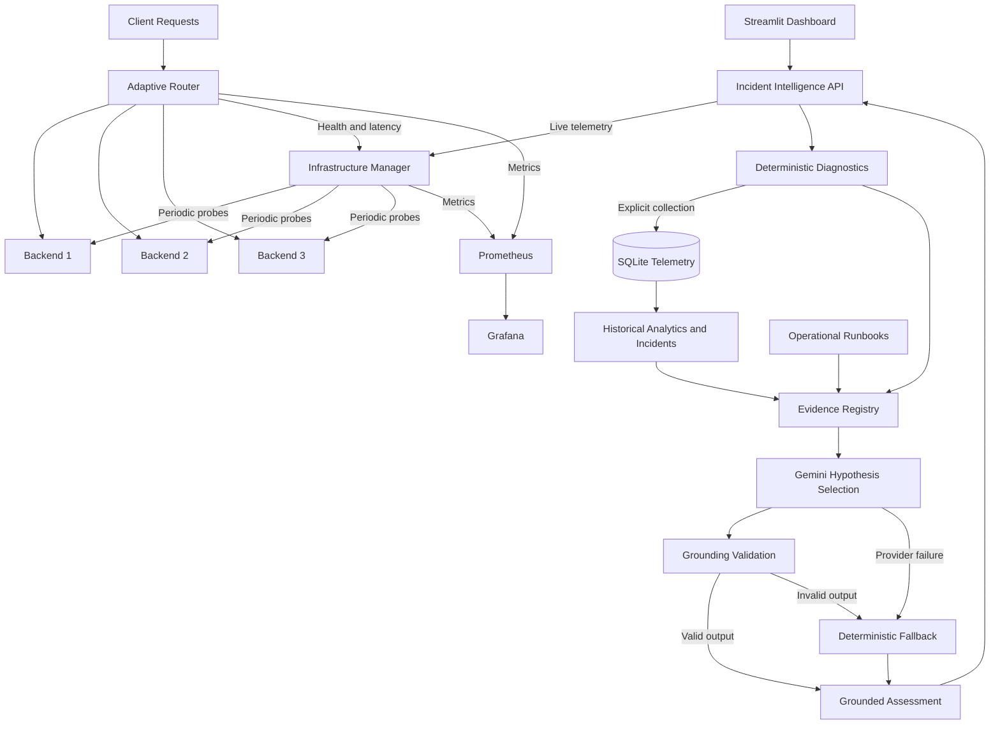

# Aegis

**AI-Powered Infrastructure & Incident Intelligence Platform**

Aegis is a distributed infrastructure and AI-assisted incident intelligence platform that combines adaptive load balancing, service health monitoring, persistent telemetry, evidence-grounded AI investigation and operational analytics.

The platform integrates a simulated microservice environment with an incident intelligence layer designed to help human operators investigate infrastructure degradation without executing autonomous remediation.

## Key Features

### Infrastructure and Adaptive Routing

- Latency-aware weighted routing across multiple backend services.
- Continuous backend probing and health monitoring.
- Exponentially weighted moving average (EWMA) latency estimation.
- Health-aware backend selection and exclusion of unhealthy services.
- Configurable latency simulation and failure injection.
- Prometheus instrumentation and Grafana dashboards.
- Infrastructure benchmarking and performance analysis utilities.

### AI-Powered Incident Intelligence

- Deterministic infrastructure diagnostics and severity classification.
- Evidence-grounded hypothesis selection using Google Gemini.
- Backend-specific evidence validation and constrained model outputs.
- Issue-aware operational runbook retrieval.
- Bounded retries, request timeouts and deterministic fallback.
- Human-in-the-loop investigation without autonomous remediation.

### Historical Telemetry and Incident Management

- Persistent SQLite storage of timestamped infrastructure observations.
- Incident detection, deduplication and lifecycle tracking.
- Recovery detection based on subsequent telemetry observations.
- Historical latency analysis and observed threshold violation rates.
- Transactional persistence of snapshots, findings and incident updates.

### Operational Dashboard

An interactive Streamlit and Plotly workspace provides four operational views:

| Workspace | Capabilities |
|---|---|
| Infrastructure Overview | Backend health, latency, severity and diagnostic findings |
| Historical Analytics | Stored observations, latency trends and threshold violations |
| Incident Management | Open and resolved incidents, observation counts and supporting snapshots |
| AI Investigation | Evidence-grounded hypotheses, runbooks, recommended checks and uncertainty |

## Architecture



The infrastructure and intelligence layers operate within a unified Docker Compose deployment while maintaining separate application dependencies and modular responsibilities.

## Adaptive Routing Strategy

The infrastructure manager periodically probes backend services and estimates latency using an exponentially weighted moving average:

```
EWMA(t) = alpha * latency(t) + (1 - alpha) * EWMA(t-1)
```

The smoothing factor is configured as `alpha = 0.3`.

The router retrieves backend health and latency observations from the manager. Healthy backends with valid positive latency estimates receive weights proportional to inverse EWMA latency:

```
weight(i) = 1 / EWMA(i)

P(i) = weight(i) / sum(weight(j))
```

Lower-latency backends therefore receive a higher probability of selection, while unhealthy backends are excluded.

If no eligible backend is available, the router returns HTTP 503. Failed upstream requests return HTTP 502.

This implementation provides adaptive, health-aware routing across a fixed set of backend replicas rather than dynamic replica autoscaling.

## Evidence-Grounded AI Investigation

Aegis separates deterministic infrastructure observations from AI-assisted hypothesis selection.

The investigation pipeline:

1. Retrieve live backend health and latency telemetry.
2. Validate observations and classify severity deterministically.
3. Retrieve relevant historical observations and operational runbooks.
4. Construct a deterministic evidence registry.
5. Provide Gemini with permitted hypothesis candidates and supporting context.
6. Validate returned hypothesis identifiers, backend associations and evidence references.
7. Render unconfirmed hypotheses, factual observations and recommended diagnostic checks.
8. Return deterministic diagnostics if AI generation or validation fails.

The model selects hypotheses from an application-defined catalogue rather than generating unrestricted factual infrastructure claims.

Accepted hypothesis wording and recommended checks are rendered from trusted application definitions.

Evidence validation establishes consistency with the available observations. It does not establish that a selected hypothesis is the actual root cause.

## Technology Stack

| Component | Technology |
|---|---|
| Infrastructure services | Python 3.11, FastAPI |
| Incident intelligence | Python 3.12, FastAPI |
| AI integration | Google Gemini API |
| Dashboard | Streamlit |
| Visualization | Plotly, Grafana |
| Infrastructure monitoring | Prometheus |
| Persistence | SQLite |
| HTTP communication | HTTPX |
| Testing | Pytest, Streamlit AppTest |
| Deployment | Docker, Docker Compose |
| Performance analysis | Python benchmarking and analysis utilities |

## Repository Structure

```
aegis/
├── router.py                  # Active adaptive routing service
├── backend.py                 # Simulated backend service
├── manager/
│   └── manager.py             # Health probes and EWMA telemetry
├── bench/                     # Infrastructure benchmarking
├── analysis/                  # Performance analysis
├── grafana/                   # Dashboard provisioning
├── prometheus.yml             # Monitoring configuration
├── tests/                     # Infrastructure regression tests
├── intelligence/
│   ├── app/                   # Incident intelligence API
│   ├── dashboard/             # Streamlit application
│   ├── runbooks/              # Operational knowledge
│   ├── evaluation/            # Synthetic and adversarial evaluation
│   ├── tests/                 # Intelligence regression tests
│   ├── Dockerfile
│   └── requirements.txt
├── Dockerfile
├── docker-compose.yml         # Unified deployment
├── .dockerignore
├── .env.example
├── requirements.txt
└── README.md
```

The root Docker Compose configuration is the recommended deployment entry point.

Additional intelligence-layer implementation details are available in [intelligence/README.md](intelligence/README.md).

## Getting Started

### Prerequisites

- Git
- Docker Engine or a compatible Docker runtime
- Docker Compose v2
- Optional Gemini API key

A Gemini API key is not required for deterministic diagnostics, telemetry collection or historical analytics.

### 1. Clone the repository

```bash
git clone https://github.com/paramsrinivas/aegis.git
cd aegis
```

### 2. Configure the environment

```bash
test -f .env || cp .env.example .env
chmod 600 .env
```

Configure the optional Gemini credential in `.env`.

| Variable | Purpose |
|---|---|
| `GEMINI_API_KEY` | Optional Gemini API credential |
| `GEMINI_MODEL` | Gemini model identifier |
| `GRAFANA_ADMIN_PASSWORD` | Local Grafana administrator password |
| `AEGIS_TELEMETRY_VOLUME` | Persistent telemetry volume name |

The default Gemini model is `gemini-3.1-flash-lite`.

Do not commit populated environment files. Change the default Grafana password when appropriate.

### 3. Build and launch the platform

```bash
docker compose config --quiet
docker compose build
docker compose up -d --no-build --wait
docker compose ps
```

The unified deployment starts nine services:

- Adaptive router
- Infrastructure manager
- Three simulated backend services
- Prometheus
- Grafana
- Incident intelligence API
- Streamlit dashboard

### 4. Access the platform

| Service | URL |
|---|---|
| Incident Intelligence Dashboard | http://127.0.0.1:8501 |
| Intelligence API | http://127.0.0.1:8010 |
| Interactive API Documentation | http://127.0.0.1:8010/docs |
| Adaptive Router | http://127.0.0.1:8000 |
| Infrastructure Manager | http://127.0.0.1:8001 |
| Prometheus | http://127.0.0.1:9090 |
| Grafana | http://127.0.0.1:3000 |

Published service ports are restricted to localhost.

### 5. Verify the deployment

```bash
curl -fsS http://127.0.0.1:8000/healthz

curl -fsS http://127.0.0.1:8001/weights

curl -fsS http://127.0.0.1:8010/healthz

curl -fsS http://127.0.0.1:8501/_stcore/health
```

## Example Investigation

The default infrastructure configuration intentionally simulates heterogeneous backend performance.

| Backend | Configured mean latency | Latency standard deviation | Configured failure rate |
|---|---:|---:|---:|
| backend1 | 30 ms | 5 ms | 0% |
| backend2 | 120 ms | 40 ms | 5% |
| backend3 | 40 ms | 10 ms | 0% |

These are simulation parameters rather than measured production performance.

### Send a routed request

```bash
curl http://127.0.0.1:8000/predict
```

### Inspect live infrastructure telemetry

```bash
curl http://127.0.0.1:8001/weights
```

### Run deterministic diagnostics

```bash
curl 'http://127.0.0.1:8010/investigate?threshold_ms=100'
```

### Collect historical observations

```bash
for i in 1 2 3 4 5; do
  curl -fsS -X POST \
    'http://127.0.0.1:8010/collect?threshold_ms=100'
  echo
  sleep 5
done
```

### Inspect incident history

```bash
curl http://127.0.0.1:8010/incidents

curl 'http://127.0.0.1:8010/trends/backend2?threshold_ms=100'
```

### Generate an AI-assisted investigation

```bash
curl 'http://127.0.0.1:8010/explain?threshold_ms=100'
```

When a configured Gemini provider is available, the response includes validated evidence references, unconfirmed hypotheses, recommended diagnostic checks and explicit uncertainty.

If AI generation is unavailable or produces invalid output, deterministic fallback preserves useful diagnostic information.

The default threshold of 100 ms is illustrative and does not represent an established production service-level objective.

## API Reference

### Infrastructure

| Service | Method | Endpoint | Description |
|---|---|---|---|
| Router | GET | `/healthz` | Router health |
| Router | GET | `/predict` | Route a request to an eligible backend |
| Router | GET | `/metrics` | Router instrumentation |
| Manager | GET | `/weights` | Backend health and EWMA latency |
| Manager | GET | `/metrics` | Infrastructure instrumentation |

### Incident Intelligence

| Method | Endpoint | Description |
|---|---|---|
| GET | `/healthz` | API health |
| GET | `/investigate` | Live deterministic diagnostics |
| GET | `/explain` | Evidence-grounded AI investigation |
| POST | `/collect` | Collect and persist telemetry |
| GET | `/snapshots` | List stored snapshots |
| GET | `/snapshots/{id}` | Retrieve snapshot details |
| GET | `/historical-backends` | Discover historically observed backends |
| GET | `/history/{backend}` | Backend observation history |
| GET | `/trends/{backend}` | Historical trend analysis |
| GET | `/incidents` | List tracked incidents |
| GET | `/incidents/{id}` | Retrieve incident details |

## Evaluation and Testing

### Verified Results

| Evaluation | Result |
|---|---:|
| Total automated regression tests | 235/235 passed |
| Intelligence regression tests | 232/232 passed |
| Infrastructure regression tests | 3/3 passed |
| Synthetic incident scenarios | 8/8 passed |
| Deterministic diagnostic checks | 64/64 passed |
| Adversarial simulated model outputs rejected | 10/10 |
| Unified Docker services deployed | 9/9 |
| Live containerized Gemini integration | Passed |
| Historical telemetry migration | Passed |
| SQLite database integrity | Passed |
| Dependency consistency | Passed |

The intelligence regression suite completed in 10.40 seconds and the infrastructure regression suite completed in 0.14 seconds during the verified integration run.

The synthetic evaluation covers healthy infrastructure, elevated latency, backend failures, missing telemetry, mixed incidents and threshold boundaries.

The adversarial evaluation covers fabricated evidence, invented hypotheses, incorrect backend associations, unsupported root-cause claims, unauthorized actions, duplicate hypotheses, malformed output and severity overrides.

Detailed benchmark results are available in [intelligence/evaluation/results.json](intelligence/evaluation/results.json).

These results describe the implemented test cases and simulated adversarial outputs. They do not establish general LLM accuracy, comprehensive security guarantees or production-scale reliability.

### Run intelligence regression tests

From the repository root:

```bash
docker run --rm \
  -v "$PWD/intelligence/tests:/app/tests:ro" \
  aegis-intelligence:1.0.0 \
  python -m pytest -q -p no:cacheprovider
```

### Run infrastructure regression tests

```bash
docker run --rm \
  -v "$PWD/tests:/app/tests:ro" \
  aegis-router \
  sh -c 'python -m pip install pytest==8.3.5 -q && python -m pytest tests -q -p no:cacheprovider'
```

### Run synthetic and adversarial evaluation

```bash
docker run --rm \
  -v "$PWD/intelligence/evaluation:/app/evaluation" \
  aegis-intelligence:1.0.0 \
  python -m evaluation.benchmark
```

The benchmark writes its results to `intelligence/evaluation/results.json`.

## Engineering Design Decisions

### Deterministic diagnostics before AI

Infrastructure severity and factual observations are generated by application logic rather than delegated to the language model.

### Constrained model output

Gemini selects from permitted hypothesis candidates. Application-level validation rejects unsupported identifiers, evidence references and backend associations.

### Graceful degradation

Provider errors and invalid AI responses trigger deterministic fallback, allowing infrastructure diagnostics to remain useful without a successful model response.

### Transactional persistence

Telemetry snapshots, backend observations, diagnostic findings and incident lifecycle updates are persisted using SQLite transactions.

### Efficient historical discovery

A dedicated historical backend discovery endpoint replaces a previous dashboard discovery path requiring up to 101 API requests with a single request.

### Modular deployment

Infrastructure and intelligence services maintain separate Python dependency sets and Docker build contexts while communicating through internal service networking.

The intelligence API and dashboard run as non-root containers.

## Persistent Storage

Historical telemetry and incident records are stored in a Docker named volume.

Stop the platform while
