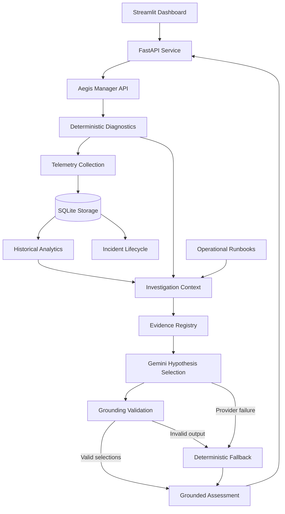

# Aegis Intelligence

> **Aegis v2 update:** This branch includes pgvector
> retrieval, coverage-aware ranking, Google ADK
> orchestration and structured diagnostic observability.
>
> See the [v2 architecture](rag/ARCHITECTURE.md),
> [consolidated evaluation](rag/PHASE7_EVALUATION.md)
> and [root README](../README.md) for current results
> and setup instructions.
>
> The original intelligence-layer documentation below
> describes the v1 baseline unless otherwise indicated.


> **Deployment note:** This directory is the intelligence
> layer of the unified Aegis platform. For the recommended
> nine-service Docker deployment, follow the
> [root README](../README.md).
>
> The standalone setup instructions below are retained
> for independent intelligence-layer development.


**Enterprise Incident Intelligence Platform**

Evidence-grounded AI-assisted infrastructure diagnostics, historical telemetry analysis and incident management.

Aegis AI extends the Aegis load-balancing infrastructure with an incident intelligence layer that combines deterministic diagnostics, persistent telemetry, constrained LLM hypothesis selection and an interactive operational dashboard.

The platform is designed to assist human operators in investigating infrastructure incidents without executing autonomous remediation.

## Key Features

- **Live infrastructure diagnostics:** Backend health monitoring, EWMA latency analysis, threshold-based findings and deterministic severity classification.
- **Evidence-grounded AI investigation:** Gemini selects hypotheses from a predefined catalogue, with validated evidence references and backend-specific constraints.
- **Historical telemetry:** Persistent SQLite storage of timestamped infrastructure observations.
- **Incident lifecycle management:** Incident detection, deduplication, observation tracking and recovery detection.
- **Historical analytics:** Latency trends, observed threshold violation rates and telemetry availability.
- **Runbook retrieval:** Issue-aware retrieval of relevant operational guidance.
- **Provider resilience:** Bounded retry attempts, request timeouts and deterministic fallback when AI investigation is unavailable.
- **Interactive dashboard:** Streamlit and Plotly interface for infrastructure monitoring, historical analytics, incident management and AI investigation.

## Architecture



## Evidence-Grounded Investigation

Aegis AI separates factual infrastructure observations from AI-generated hypothesis selection.

1. Retrieve live backend telemetry from the Aegis manager.
2. Validate telemetry and classify incident severity deterministically.
3. Retrieve relevant historical observations and operational runbooks.
4. Construct a deterministic evidence registry.
5. Provide Gemini with permitted hypothesis candidates.
6. Validate model selections against the evidence registry.
7. Render observations, unconfirmed hypotheses and recommended diagnostic checks.
8. Return deterministic diagnostics if AI investigation fails.

The model cannot introduce arbitrary factual observations into the accepted assessment. Hypothesis identifiers, backend associations and evidence references are validated by application logic.

Evidence validation does not establish that a hypothesis is the actual root cause.

## Technology Stack

| Component | Technology |
|---|---|
| Backend | Python 3.12, FastAPI |
| AI integration | Google Gemini API |
| Dashboard | Streamlit |
| Visualization | Plotly |
| Persistence | SQLite |
| HTTP communication | HTTPX |
| Testing | Pytest, Streamlit AppTest |
| Infrastructure integration | Aegis Manager API |

## Repository Structure

```
aegis-ai/
├── app/
│   ├── main.py
│   ├── ai.py
│   ├── evidence.py
│   ├── reasoning.py
│   ├── grounding.py
│   ├── knowledge.py
│   ├── collector.py
│   ├── storage.py
│   ├── incidents.py
│   ├── history.py
│   ├── trends.py
│   └── historical_context.py
├── dashboard/
├── evaluation/
├── runbooks/
├── tests/
├── .streamlit/
├── .env.example
├── requirements.txt
└── README.md
```

## Getting Started

### Prerequisites

- Python 3.12
- A running Aegis infrastructure manager
- Optional Gemini API key for AI-assisted investigation

Infrastructure repository: [Aegis](https://github.com/paramsrinivas/aegis)

The Aegis manager must expose a compatible `/weights` endpoint containing backend health and EWMA latency observations.

### 1. Set up the Python environment

```bash
python3.12 -m venv .venv
source .venv/bin/activate
python -m pip install -r requirements.txt
```

### 2. Configure environment variables

```bash
cp .env.example .env
```

Edit `.env` as required.

| Variable | Purpose |
|---|---|
| `AEGIS_MANAGER_URL` | Aegis infrastructure manager URL |
| `GEMINI_API_KEY` | Optional Gemini API credential |
| `GEMINI_MODEL` | Gemini model identifier |
| `AEGIS_DB_PATH` | SQLite database location |
| `AEGIS_AI_API_URL` | Dashboard connection to FastAPI |

Do not commit the populated `.env` file.

### 3. Start the API

From the repository root:

```bash
source .venv/bin/activate

set -a
source .env
set +a

uvicorn app.main:app --host 127.0.0.1 --port 8010
```

Interactive API documentation:

http://127.0.0.1:8010/docs

### 4. Start the dashboard

In a separate terminal, from the repository root:

```bash
source .venv/bin/activate

set -a
source .env
set +a

PYTHONPATH="$PWD" python -m streamlit run dashboard/main.py
```

Open:

http://127.0.0.1:8501

## Dashboard

The incident intelligence workspace contains four operational sections.

| Section | Capabilities |
|---|---|
| Infrastructure Overview | Live health, latency, severity and diagnostic findings |
| Historical Analytics | Stored observations, latency trends and threshold violations |
| Incident Management | Open and resolved incidents, observation counts and supporting snapshots |
| AI Investigation | Evidence-grounded hypotheses, runbooks, recommended checks and uncertainty |

Telemetry collection is explicitly initiated through the dashboard or collection API. The application does not currently run a continuous background collector.

## API Reference

| Method | Endpoint | Description |
|---|---|---|
| GET | `/healthz` | API health |
| GET | `/investigate` | Live deterministic diagnostics |
| GET | `/explain` | Evidence-grounded investigation |
| POST | `/collect` | Collect and persist telemetry |
| GET | `/snapshots` | List stored snapshots |
| GET | `/snapshots/{id}` | Retrieve a stored snapshot |
| GET | `/historical-backends` | Discover historically observed backends |
| GET | `/history/{backend}` | Backend observation history |
| GET | `/trends/{backend}` | Historical trend analysis |
| GET | `/incidents` | List tracked incidents |
| GET | `/incidents/{id}` | Retrieve incident details |

### Example requests

```bash
curl http://127.0.0.1:8010/healthz

curl 'http://127.0.0.1:8010/investigate?threshold_ms=100'

curl -X POST \
  'http://127.0.0.1:8010/collect?threshold_ms=100'

curl 'http://127.0.0.1:8010/trends/backend2?threshold_ms=100'

curl 'http://127.0.0.1:8010/explain?threshold_ms=100'
```

The default latency threshold of 100 ms is illustrative and does not represent an established production SLO.

## Evaluation and Testing

Run the automated regression suite:

```bash
python -m pytest -q
```

Run the synthetic diagnostic and adversarial grounding benchmark:

```bash
python -m evaluation.benchmark
```

### Verified Evaluation Results

| Evaluation | Result |
|---|---|
| Automated regression suite | 232 passing tests |
| Synthetic incident scenarios | 8/8 passed |
| Diagnostic benchmark checks | 64/64 passed |
| Adversarial model outputs rejected | 10/10 |

The adversarial evaluation includes fabricated evidence, invented hypotheses, incorrect backend associations, unsupported root-cause claims, unauthorized actions and malformed output.

These results measure behavior on the implemented test cases. They do not establish general LLM accuracy, comprehensive security guarantees or production reliability.

Benchmark results are available in `evaluation/results.json`.

## Engineering Design Decisions

### Deterministic diagnostics before AI

Severity classification and factual observations are generated by application logic rather than delegated to the language model.

### Constrained hypothesis selection

The model selects from an application-defined catalogue. Accepted hypothesis wording and recommended checks are rendered from trusted application definitions.

### Graceful degradation

Provider failures and invalid model outputs trigger deterministic fallback, preserving useful diagnostic information without requiring a successful AI response.

### Transactional persistence

Telemetry snapshots, backend observations, findings and incident lifecycle updates are persisted using SQLite transactions.

### Efficient historical discovery

Historical backend discovery uses a dedicated database query rather than fetching individual snapshot details. This replaces a previous dashboard discovery path requiring up to 101 API requests with one request.

## Safety and Operational Boundaries

- Infrastructure diagnostics are read-only.
- Telemetry collection writes to local application storage.
- No autonomous remediation is implemented.
- AI-selected hypotheses remain unconfirmed.
- Human review is required before operational action.
- Historical samples do not establish continuous degradation.
- Observed threshold violation rates are not SLA measurements.
- AI investigation sends relevant telemetry, evidence and runbook context to the configured Gemini provider.

## Limitations

Aegis AI currently uses backend health and EWMA latency as its primary live diagnostic signals. It does not independently observe CPU utilization, memory pressure, distributed traces or application logs.

The platform is a locally developed engineering prototype, not a production-certified incident management system. Authentication, multi-tenant isolation, continuous collection and distributed persistence are outside the current implementation scope.

## Project Development

| Version | Milestone |
|---|---|
| v0.2.0 | Reliable AI diagnostic foundation |
| v0.3.0 | Evidence grounding and adversarial evaluation |
| v0.4.0 | Historical telemetry and incident lifecycle |
| v0.5.0 | Interactive incident intelligence dashboard |

Aegis AI demonstrates infrastructure integration, applied AI reliability, backend engineering, operational analytics and human-in-the-loop incident investigation.
## Docker Deployment

### Prerequisites

- Docker Engine and Docker Compose v2
- Running Aegis infrastructure
- Existing Aegis Docker network (`aegis_aegisnet` by default)

The containerized API communicates with the Aegis manager at `http://manager:8001`.

### Configuration

```bash
test -f .env || cp .env.example .env
chmod 600 .env
```

Configure the optional Gemini API key in `.env`. Deterministic diagnostics remain available without an API key.

Stop any native application processes occupying ports 8010 and 8501 before starting the containers.

### Build and Start

```bash
docker compose config --quiet
docker compose build api
docker compose up -d --no-build --wait
docker compose ps
```

| Service | URL |
|---|---|
| Dashboard | http://127.0.0.1:8501 |
| FastAPI | http://127.0.0.1:8010 |
| Interactive API documentation | http://127.0.0.1:8010/docs |

Both services run as non-root containers and publish their ports to localhost.

### Deployment Verification

```bash
curl -fsS http://127.0.0.1:8010/healthz
curl -fsS http://127.0.0.1:8501/_stcore/health
curl -fsS http://127.0.0.1:8010/investigate
```

### Persistent Storage

Telemetry snapshots and incident records are stored in a Docker named volume, separate from the native application's database.

Stop the deployment while preserving stored data:

```bash
docker compose down
```

Do not use `docker compose down -v` unless intentionally deleting persisted telemetry.

### Container Regression Tests

```bash
docker run --rm \
  -v "$PWD/tests:/app/tests:ro" \
  aegis-ai:1.0.0-rc1 \
  python -m pytest -q -p no:cacheprovider
```

### Verified Deployment Results

| Validation | Result |
|---|---|
| Native macOS regression tests | 232 passed |
| Linux ARM64 container regression tests | 232 passed |
| Synthetic incident scenarios | 8/8 passed |
| Deterministic diagnostic checks | 64/64 passed |
| Adversarial simulated outputs rejected | 10/10 |
| Live containerized Gemini integration | Passed |
| Live provider retry recovery | Verified |
| Container recreation persistence | 5 snapshots and 1 incident preserved |
| Incident deduplication | 5 observations consolidated into 1 incident |

The deployment was tested using Docker and Colima on macOS with Linux ARM64 containers. These results demonstrate functionality within the tested environment, not production-scale performance or general LLM accuracy.
