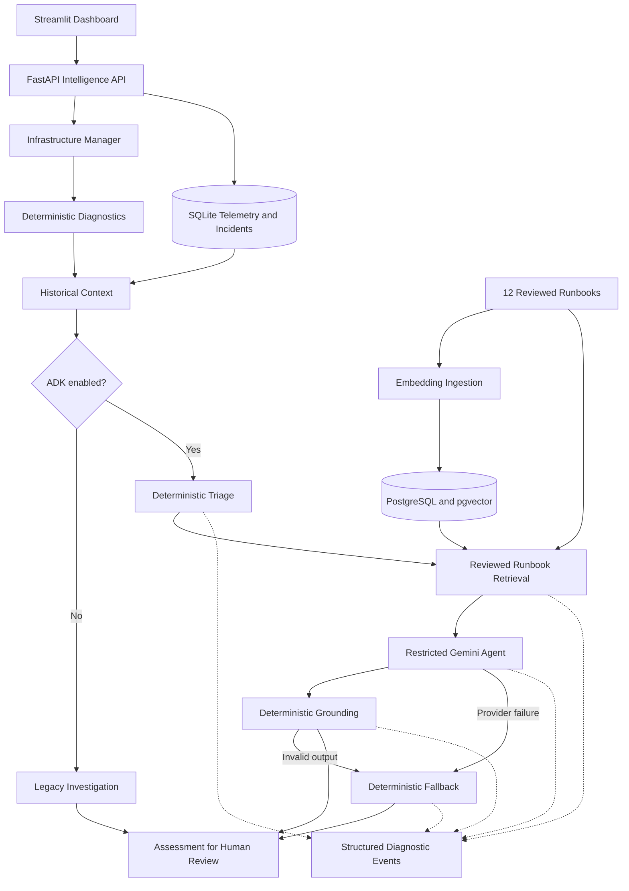

# Aegis v2 — Architecture

## System Overview

Aegis v2 extends the original adaptive infrastructure
routing and incident intelligence platform with
reviewed-document retrieval, Google ADK orchestration
and structured diagnostic observability.

## Diagnostic Execution

## Retrieval Architecture

The retrieval subsystem implements:

- Gemini document and query embeddings.
- PostgreSQL full-text search.
- pgvector cosine-similarity retrieval.
- Reciprocal rank fusion.
- Weighted hybrid retrieval.
- Issue-aware coverage selection.
- Reviewed-document provenance validation.

Semantic retrieval with issue coverage is the
selected opt-in runtime strategy.

Hybrid retrieval remains an evaluated alternative.

## Agent Architecture

Google ADK coordinates a bounded diagnostic workflow
with one LLM agent and three deterministic stages.

The model selects permitted hypotheses and evidence
references rather than generating unrestricted
infrastructure claims.

The agent has no remediation tools or autonomous
operational permissions.

## Storage Responsibilities

| Store | Responsibility |
|---|---|
| SQLite | Authoritative telemetry and incident records |
| PostgreSQL and pgvector | Reviewed runbook retrieval index |
| Local Markdown | Reviewed runbook source of truth |
| Container logs | Structured diagnostic events |

The vector database is not an authoritative
telemetry or incident store.

## Runtime Configuration

Both v2 features are opt-in:

- AEGIS_RAG_MODE=semantic_coverage
- AEGIS_AGENT_MODE=adk

Both flags default to off.

The existing explanation endpoint remains available
with deterministic fallback when AI or retrieval
dependencies fail.

## Observability

Diagnostic events include:

- Correlation trace IDs.
- Stage execution durations.
- Retrieval strategy and document count.
- Provider-reported token usage when available.
- Classified failure reasons.
- Final AI availability and fallback status.

The application emits structured JSON logs.
No external tracing backend is required.

## Operational Boundaries

Aegis v2 is a local engineering prototype.

It does not implement autonomous remediation,
distributed trace persistence, production-scale
vector retrieval or confirmed root-cause inference.

Successful live Gemini generation and live token
reporting remain unverified in v2.

See [PHASE7_EVALUATION.md](PHASE7_EVALUATION.md)
for measured results and verification limitations.
